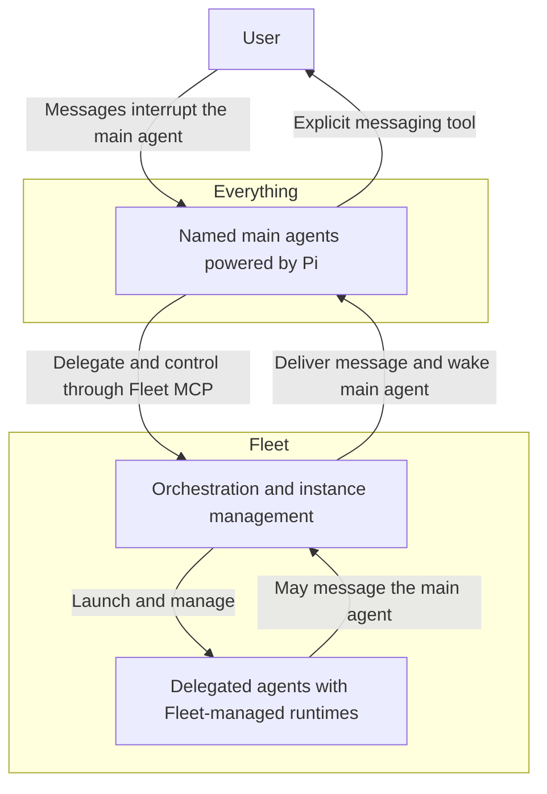
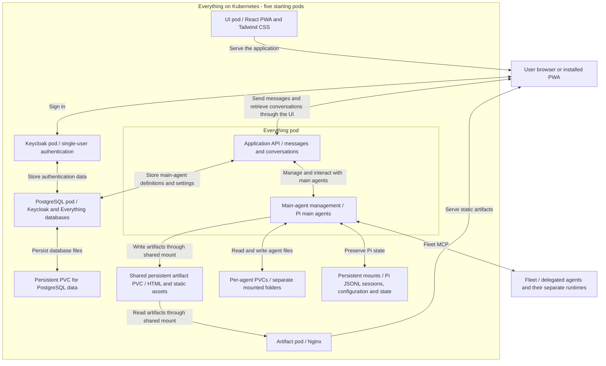

# Everything architecture

Exported from [ChatGPT Pages](https://chatgpt.com/space/page_2b6d7736601c8191bdf3ef991520ee7c) on 2026-10-11. Source last updated 2026-10-10.

[Back to the concept and high-level map](overview.md)

## Main agent harness

**Decision: Pi powers the main agents.** Everything directly controls one or more main agents whose names are chosen by the user using Pi. Fleet manages the delegated agents and their runtimes through its own separate system; Pi is selected only for the main agents.

### User interruption

A user message interrupts the main agent's current execution and is injected into its conversation so the agent can respond promptly. The agent replies through its explicit messaging tool. After replying, it can attempt to resume its previous work or continue according to the user's new direction.

## Kubernetes deployment

Everything will be self-hosted on Kubernetes, starting with five pods.

| Pod | Responsibility |
| --- | --- |
| Keycloak | Authentication and user management for the single user. |
| Everything | Application API, conversation and message handling, Web Push delivery, main-agent management, and Pi running one or more named main agents. |
| UI | Serve the React progressive web app (PWA), styled with Tailwind CSS. |
| Artifact | Nginx serving static artifacts from a persistent PVC shared with the Everything pod. |
| PostgreSQL | Persistent database server with separate databases for Keycloak and Everything. Everything stores main-agent definitions and settings here. |

This is a single-user system. Keycloak provides login; no multi-user authorization or role model is planned.

The Everything pod is the application's core. Its API lets the UI send and retrieve messages and access conversations. The API, main-agent management, and Pi runtime share this pod because they are closely coupled. It also handles Web Push delivery for the installed PWA, as described in [User Surfaces](user-surfaces.md).

### Persistence and restart behavior

Each main agent has its own folder in the Everything pod, backed by its own persistent volume claim (PVC). Notes, memory, and work files stay in that agent's storage. User-visible artifacts use the shared artifact PVC described below.

For now, Pi sessions use Pi's native JSONL files on persistent disk backed by a PVC. Everything reopens the appropriate session when restoring a main agent after a restart. The initial implementation keeps Pi's existing session persistence; a custom PostgreSQL session adapter is deferred.

All application and agent data must survive pod restarts and replacement. Alongside agent files, this includes conversations, saved messages, agent sessions and stored runtime state, Pi and application configuration, credentials, and Keycloak data. Persistent storage must cover all of this state; it must not rely on a pod's ephemeral filesystem.

Losing an in-flight message during a restart is acceptable. Strict message-delivery guarantees are not required. This exception does not extend to already stored messages, conversations, or other persistent data.

### Database storage

A PostgreSQL container runs in its own pod with a persistent PVC for database files. Keycloak stores its data in a dedicated database on this server. PostgreSQL is supported directly by Keycloak. [Keycloak database documentation](https://www.keycloak.org/server/db)

Everything stores its main-agent definitions, user-chosen names, and settings in a separate application database on the same PostgreSQL server. Everything owns the list of agents and uses their saved definitions to create or restore Pi sessions. An agent's definition persists independently of whether that agent is currently running. Agent names are not hard-coded.

### Artifact serving

A dedicated artifact pod runs Nginx. A shared persistent PVC is mounted into both the Everything pod and the artifact pod. Main agents write HTML files and other static assets to this volume; Nginx reads the same files and serves them to the user. Artifact files survive pod restarts and replacement.

Fleet continues to own delegated-agent execution. The Pi agents in the Everything pod are the main agents only.
