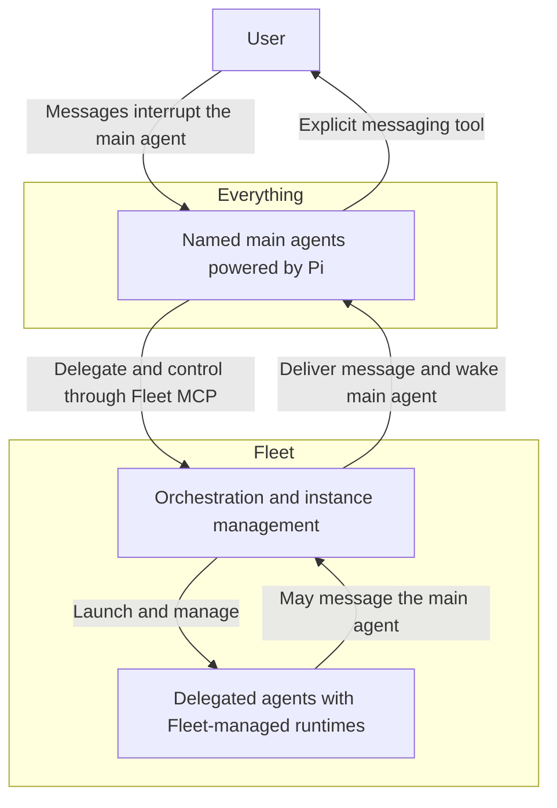
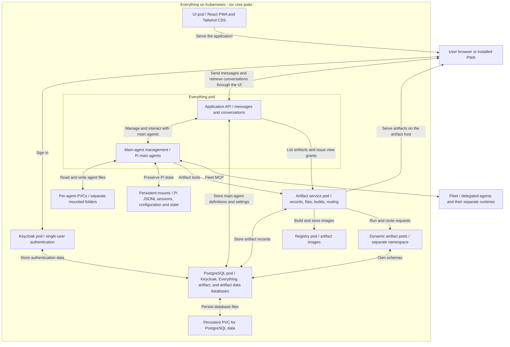
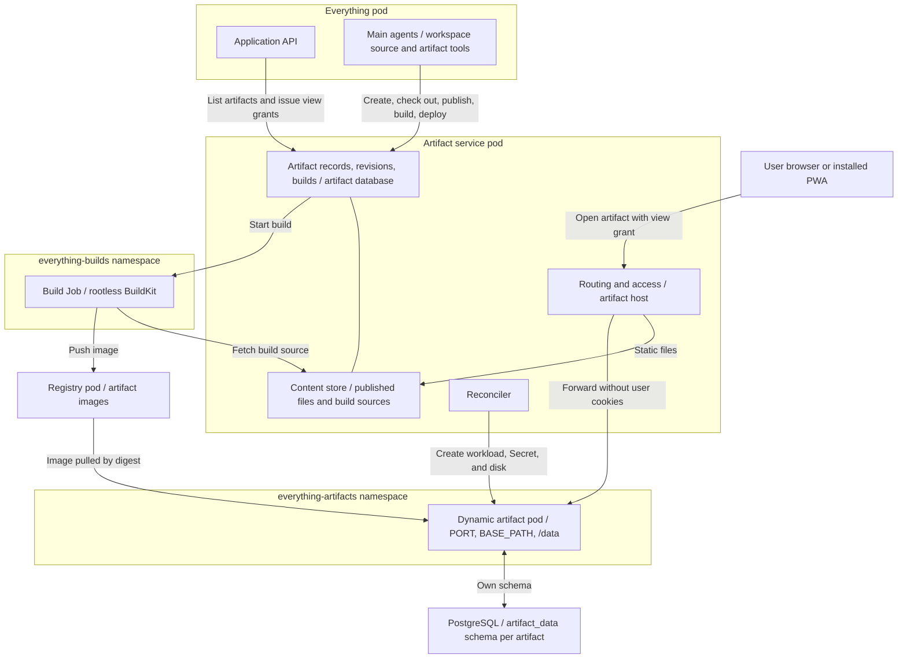

# Everything architecture

Exported from [ChatGPT Pages](https://chatgpt.com/space/page_2b6d7736601c8191bdf3ef991520ee7c) on 2026-10-11. Source last updated 2026-10-10.

[Back to the concept and high-level map](overview.md)

## Main agent harness

**Decision: Pi powers the main agents.** Everything directly controls one or more main agents whose names are chosen by the user using Pi. Fleet manages the delegated agents and their runtimes through its own separate system; Pi is selected only for the main agents.

### User interruption

A user message interrupts the main agent's current execution and is injected into its conversation so the agent can respond promptly. The agent replies through its explicit messaging tool. After replying, it can attempt to resume its previous work or continue according to the user's new direction.

## Kubernetes deployment

Everything will be self-hosted on Kubernetes with six core pods. The artifact service adds one pod for each running dynamic artifact and a short-lived Job for each image build.

| Pod | Responsibility |
| --- | --- |
| Keycloak | Authentication and user management for the single user. |
| Everything | Application API, conversation and message handling, Web Push delivery, main-agent management, and Pi running one or more named main agents. |
| UI | Serve the React progressive web app (PWA), styled with Tailwind CSS. |
| Artifact service | Track shared artifacts in PostgreSQL, store published files and build sources, build images, run dynamic artifacts, and serve artifacts on the artifact host. |
| Registry | Store artifact images, with access controlled by the artifact service. |
| PostgreSQL | Persistent database server with separate databases for Keycloak, Everything, and the artifact service, plus a database holding each dynamic artifact's own schema. Everything stores main-agent definitions and settings here. |

This is a single-user system. Keycloak provides login; no multi-user authorization or role model is planned.

The Everything pod is the application's core. Its API lets the UI send and retrieve messages and access conversations. The API, main-agent management, and Pi runtime share this pod because they are closely coupled. It also handles Web Push delivery for the installed PWA, as described in [User Surfaces](user-surfaces.md).

Fleet continues to own delegated-agent execution. The Pi agents in the Everything pod are the main agents only.

### Persistence and restart behavior

Each main agent has its own folder in the Everything pod, backed by its own persistent volume claim (PVC). Notes, memory, and work files stay in that agent's storage, including the source of artifacts it is working on. Published artifacts belong to the artifact service described below, not to any agent's folder.

For now, Pi sessions use Pi's native JSONL files on persistent disk backed by a PVC. Everything reopens the appropriate session when restoring a main agent after a restart. The initial implementation keeps Pi's existing session persistence; a custom PostgreSQL session adapter is deferred.

All application and agent data must survive pod restarts and replacement. Alongside agent files, this includes conversations, saved messages, agent sessions and stored runtime state, Pi and application configuration, credentials, Keycloak data, published artifacts, artifact images, and the databases and disks of dynamic artifacts. Persistent storage must cover all of this state; it must not rely on a pod's ephemeral filesystem.

Losing an in-flight message during a restart is acceptable. Strict message-delivery guarantees are not required. This exception does not extend to already stored messages, conversations, or other persistent data.

### Database storage

A PostgreSQL container runs in its own pod with a persistent PVC for database files. Keycloak stores its data in a dedicated database on this server. PostgreSQL is supported directly by Keycloak. [Keycloak database documentation](https://www.keycloak.org/server/db)

Everything stores its main-agent definitions, user-chosen names, and settings in a separate application database on the same PostgreSQL server. Everything owns the list of agents and uses their saved definitions to create or restore Pi sessions. An agent's definition persists independently of whether that agent is currently running. Agent names are not hard-coded.

The artifact service stores artifact records, revisions, builds, and deployments in its own database. Dynamic artifacts that request persistence each get a role and schema in a separate `artifact_data` database, so artifact code never shares a database with application data.

## Artifacts

**Decision: artifacts are tracked, shared records served by a dedicated artifact service.** An artifact is a named, linkable piece of work that main agents publish for the user: static files, or a containerized application built from a Dockerfile. The artifact service keeps every artifact in PostgreSQL, so main agents list, inspect, version, and manage artifacts through tool calls instead of writing loose files to a shared volume.

### Shared ownership

Artifacts belong to the user, not to a main agent. Every main agent can list, check out, publish, build, deploy, stop, and delete any artifact; artifact queries are scoped to the user's account. The artifact service records which main agent created each artifact and which made each revision, build, and deployment. Authorship is shown to the user and to other main agents; it never limits access. Deleting a main agent leaves its artifacts in place.

### Kinds and releases

Each artifact has a kind, chosen when it is created and fixed afterwards:

- A **static** artifact serves files. Each publish creates a revision, and one revision is live.
- A **dynamic** artifact runs a container image built from a Dockerfile. Each build creates an image, and one deployment, a build with its runtime settings, is live.

Main agents are coding agents with their own workspaces. A main agent writes an artifact's source in its workspace and sends a directory to the artifact service through a tool call; the artifact service stores an immutable snapshot. The workspace is the working copy, and the artifact service holds the published history. Re-activating an earlier revision, or deploying an earlier build, rolls an artifact back.

The artifact service keeps the full source of every static revision and every build, so any main agent can check out an artifact, change it, and publish again, including work another main agent started. Files are stored by content hash, with PostgreSQL mapping each path to its hash; a publish uploads only files the service does not already have. Each artifact keeps its 20 newest revisions, builds, and deployments, always including the live ones. Reclaiming unreferenced content and registry storage is deferred.

### Agent tools

Main agents manage artifacts only through these tools, which call the artifact service's internal API. Directory paths are relative to the calling agent's workspace, or absolute under `/workspace` as its pod names it; paths that resolve outside it or into its private `.pi` directory, including through symbolic links, are refused.

| Tool | Kind | Purpose |
| --- | --- | --- |
| `create_artifact` | Both | Create a static or dynamic artifact with a slug, title, and description. The link can be shared before anything is published. |
| `list_artifacts` | Both | List every artifact with its kind, live release, status, and authors. |
| `get_artifact` | Both | Show metadata, the live release, recent revisions or builds, and runtime status. |
| `update_artifact` | Both | Change the title or description. The slug and kind never change, so links stay valid. |
| `delete_artifact` | Both | Remove the artifact with its revisions or images, and any pod, database schema, and disk. |
| `checkout_artifact` | Both | Copy the source of the live release, or of a given revision or build, into a workspace directory. |
| `publish_artifact` | Static | Snapshot a workspace directory as a revision and make it live, or re-activate an earlier revision. |
| `build_artifact` | Dynamic | Upload a workspace directory as build source, respecting `.dockerignore`, and start an image build from its Dockerfile. Returns a build ID immediately. |
| `get_artifact_build` | Dynamic | Show build status, image digest, and the end of the build log, optionally waiting briefly. |
| `deploy_artifact` | Dynamic | Make a build live with its port, environment, database, disk, and health-check settings. Defaults to the latest successful build. |
| `stop_artifact` | Dynamic | Stop the artifact's pod and keep its database and disk. |
| `get_artifact_logs` | Dynamic | Show recent container logs, including those from the last crash. |
| `view_artifact` | Both | Return a short-lived pass and in-cluster links that open the artifact from the main agent's own pod as the user sees it, with ready-to-run curl and headless Chromium commands for reading its HTML, calling its API, or taking a screenshot. |

Builds return immediately so a main agent stays responsive to the user, and waiting tools return early when the user interrupts. A later version may wake the main agent when a build finishes.

`publish_artifact` and `deploy_artifact` accept an optional `basedOn` release. If another main agent has released the artifact since, the call fails with a conflict naming the newer release and its author; the caller checks it out, merges its changes, and tries again. The artifact service applies one change per artifact at a time.

The main-agent prompt says to look for an existing artifact before creating another, and how dynamic artifacts must behave: listen on `PORT`, serve routes from `/` because requests arrive without the artifact's prefix, use `BASE_PATH` only to build absolute links and asset URLs, and run without root. It also says to check an artifact with `view_artifact` after publishing or deploying, before sharing its link.

Images are always built by the artifact service from uploaded source; nothing pushes images to the registry directly. A way for main agents to query an artifact's database while debugging is deferred.

### Dynamic artifacts

1. **Build.** The artifact service stores the uploaded source, records the build, and starts a rootless BuildKit Job in a separate `everything-builds` namespace. The Job fetches the source from the artifact service, builds the image, and pushes it to the registry. The artifact service records the image digest and keeps the build log.
2. **Store.** The registry runs CNCF Distribution with one account: the chart renders its password file, the push credential build jobs use, and the pull credential artifact pods name. The artifact service reads each pushed image's digest through the registry's API and records it with the build, so images reach the registry only through builds.
3. **Deploy.** The artifact service stores the desired deployment in PostgreSQL and reconciles Kubernetes to match: a Secret with database credentials, a persistent volume claim when a disk is requested, the workload, and an internal Service. Images are referenced by digest. An artifact with a disk runs as a one-replica StatefulSet; one without a disk runs as a Deployment. Reconciliation runs on startup and after every change, so restarts and lost pods repair themselves.
4. **Serve.** The artifact service forwards the artifact's requests to its pod, as described under [Serving and access](#serving-and-access).

Each artifact pod receives:

- `PORT`, the port it must listen on, and `BASE_PATH`, the artifact's `/slug` prefix. The artifact service removes that prefix before forwarding a request, so the app serves its routes from `/` and uses `BASE_PATH` only to build absolute links and asset URLs. Root-relative redirects are kept under the prefix.
- When it requests a database, its own PostgreSQL role and schema in the `artifact_data` database, as `DATABASE_URL` and the standard `PG*` variables. The role owns only that schema, uses it as its search path, and has a connection limit.
- When it requests a disk, a persistent volume mounted at `/data`.
- A writable `/tmp`.

Artifact pods run in a separate `everything-artifacts` namespace under the restricted Pod Security Standard: as a non-root user, without a Kubernetes API token, and within fixed CPU and memory limits. Traffic flows in both directions: requests from the internet reach a pod through the artifact host and the artifact service, and pods can open connections to the internet. An artifact's database and disk survive stops and redeployments; deleting the artifact removes them.

### Serving and access

**Decision: artifacts are served from a separate artifact hostname, routed by path.** `global.externalArtifactHostname` sits beside `global.externalHostname`, and a second Ingress routes it to the artifact service. Each artifact lives at `<artifact origin>/<slug>/`. An artifact page on the application's own origin could call the Everything API with the user's session cookie and pass its origin checks, so artifacts never share that origin.

The artifact hostname shares the application's registrable domain, such as `artifacts.example.com` beside `everything.example.com`. The two are then different origins but the same site, so the artifact host's login cookie still works inside the application's split view in browsers that block third-party cookies. Artifact pages cannot act as the user: the API rejects cookie-authenticated changes from any other origin and sends no CORS headers, so cross-origin pages cannot read its responses.

Locally, the artifact origin is `http://localhost:8081`: the same hostname on a second forwarded port, which is also a different origin on the same site. An Ingress routes by hostname, not port, so the local Ingress controller listens on a second entrypoint for the artifact Ingress.

**Decision: artifacts are private.** Viewing any artifact requires the user's login. Public artifacts come later, once private artifacts work end to end; until then, external callers such as webhooks cannot reach a dynamic artifact.

- From the UI, opening an artifact asks the Everything API for a one-time view grant, which it requests from the artifact service for the signed-in user. The artifact host exchanges the grant for its own host-only session cookie.
- Opening an artifact link without that cookie, such as one sent in a message, redirects to an application page that obtains a grant, after sign-in if needed, and returns to the requested page.
- The artifact host routes only to the artifact service. Artifact pods are never exposed directly.
- Static revisions are served from the content store: `index.html` by default, content types from file extensions, and ETags from content hashes.
- Requests for a dynamic artifact are forwarded to its Service with the slug prefix removed and `X-Forwarded-Prefix` set. The artifact service removes its own and the application's login cookies before forwarding, keeping the artifact's own cookies and headers, and keeps root-relative redirects under the artifact's path. WebSockets are not forwarded yet.
- The UI lists artifacts through the Everything API, which calls the artifact service, so Everything remains the browser's only login authority.
- Main agents view artifacts from their own pods with short-lived passes that Everything requests from the artifact service's internal API on their behalf; pods never hold Keycloak credentials. A pass is opaque, stored hashed, limited to one artifact of one owner, and valid for ten minutes. It is sent as a bearer token, or a sign-in link stores it in a cookie for a headless browser; the cookie is `Secure` only over HTTPS because main agents reach the artifact host over plain HTTP inside the cluster. The artifact host strips the pass before forwarding to a dynamic artifact and leaves the app's own `Authorization` headers alone.

Everything authenticates to the artifact service's internal API with a Keycloak service client, verified through `@everything/security`. Each call carries the user's scope and the acting main agent for authorship. The internal API is reachable only inside the cluster.

### Deployment requirements

- **Build privileges.** Rootless BuildKit generally needs looser seccomp and AppArmor profiles than the restricted Pod Security Standard allows. Builds run in their own namespace with that exception.
- **Registry address.** Nodes, not pods, pull images. They pull through the registry's NodePort on their own localhost, which container runtimes reach over plain HTTP; this works in Minikube and wherever kube-proxy serves node ports on localhost. Other clusters set `artifactRegistry.pullHost` to an address their nodes trust.
- **Chart support.** The generic chart gains service-account and RBAC settings (`apiAccess`) and node ports in `serviceDefaults`, a second Ingress for `global.externalArtifactHostname` with its own origin and annotations, a template rendering the registry's credentials, and the two additional namespaces. The artifact service's Role is limited to the `everything-artifacts` and `everything-builds` namespaces. Artifacts no longer use the chart's `sharedVolumes`.

