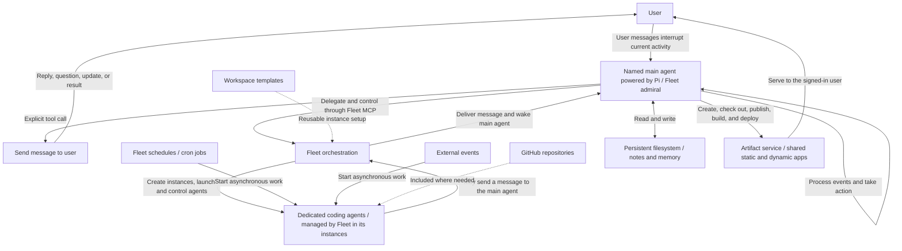

# Everything agent coordination concept

Exported from [ChatGPT Pages](https://chatgpt.com/space/page_9e931f7ec15c8191a996a3bcaacb8856) on 2026-10-11. Source last updated 2026-10-10.

Everything gives users one or more named agents that do work on their behalf, stay highly responsive, and delegate heavily to dedicated “coding agents.” Communicating with a named agent should feel like texting a person: the user sees the messages the agent chooses to send, while its internal work happens in the background. Code changes, pull requests, and research are examples; the scope remains open.

[Architecture](architecture.md)

[User Surfaces](user-surfaces.md)

## Fleet as the core orchestration layer

Fleet is the core orchestration layer for Everything. Main agents will use Fleet MCP to create agent workspaces, called instances in Fleet, and launch and control the dedicated agents they delegate work to. The main agent corresponds to Fleet's admiral.

Agent workspaces can use reusable workspace templates and include GitHub repositories where needed. Everything will build its delegation system on Fleet, making Fleet a foundational architectural choice.

## Asynchronous work and waking the main agent

Schedules, including cron jobs, and external events can start asynchronous work in dedicated agents running in Fleet instances. Fleet already supports starting instance work on a schedule.

A dedicated agent may choose to message the main agent, waking it to review the message and take action. The main agent can act in the background, delegate follow-up work through Fleet, and decide whether to contact the user through its messaging tool. This flow lets work progress without a new user message.

**Fleet dependency:** Messaging from an instance agent to the admiral is a Fleet capability still to be added. Everything's conceptual design assumes it is available; implementing that capability belongs to Fleet.

## Core interaction

Each named main agent runs its own work loop. Its turns do not automatically appear in the conversation. To communicate with the user, it must deliberately call a messaging tool.

The main agent stays engaged with the user while delegating heavily to dedicated “coding agents.” It can process updates and direct work without sending a message, then choose when to ask a question, share progress, deliver a result, or reply. The conversation should feel like an exchange of text messages. Sending a message need not end its work.

## Attention

When the user communicates, their message interrupts the main agent's current activity. The main agent must turn its attention to the user quickly and remain responsive throughout ongoing work.

Incoming user messages trigger that interruption. Outgoing messages remain deliberate actions through the messaging tool.

## Persistent storage and user apps

Each named main agent has a persistent filesystem for notes, remembered context, and other files it chooses to save. It can write information down and read it again across turns and wake-ups, giving it a durable place to keep memory and working context.

Main agents are coding agents, and apps are how they share built work with the user. An app is a page or application with its own link: static files such as HTML and supporting assets, or a containerized application built from a Dockerfile, which can ask for its own database and disk. A main agent writes an app's source in its own filesystem and publishes it through tool calls. Everything tracks each app, its revisions, and its builds, and serves it to the signed-in user. See [Apps](architecture.md#apps) for the design.

Apps are shared by all main agents. Any main agent can find an app, check out its source, change it, and publish it again, including work another main agent started. Each app records which main agent made each change.

Apps add a visual, interactive way to share work alongside the text-message conversation. The main agent can send app links through its messaging tool.

## Conceptual map

Pi is the chosen harness for the main agents only. Everything directly controls these main agents; Fleet manages the delegated agents through its own separate system. Everything can have one or more named main agents; one is shown here to explain the interaction. Each stays responsive to the user and delegates heavily. “Coding agents” is the current working term for the dedicated agents they delegate to. Main agent turns have no automatic path to the conversation; outgoing messages pass through the messaging tool.

## Example to explore

1. The user asks Everything to research an idea and make a code change.

2.

3. The main agent uses Fleet MCP to launch and control delegated agents in Fleet instances, using workspace templates and GitHub repositories where needed, while continuing to attend to the user.

4. A subagent reports an intermediate finding. The main agent can act on it without sending a chat message.

5. The user changes direction. Their message interrupts the main agent, which attends to the user promptly and incorporates the new instruction into its coordination of the work.

6. When a question, useful update, or result is ready, the main agent calls the messaging tool.

Fast, responsive attention to the user is a core requirement. The runtime mechanics for interrupting and resuming the main agent still need to be designed.

## Choices still open

- **Interruption mechanics:** How should the runtime interrupt the main agent, handle an in-flight tool call, and resume or revise its work? What happens to delegated tasks during an interruption?

- **Communication:** When should the main agent speak, ask, or stay quiet?

- **Continuity:** How should the main agent organize and retrieve the notes and context it saves in its persistent filesystem?

- **Visibility:** How much delegated activity should the user be able to inspect?

- **Execution:** How many agents are useful, and when should the system create or reuse them?
