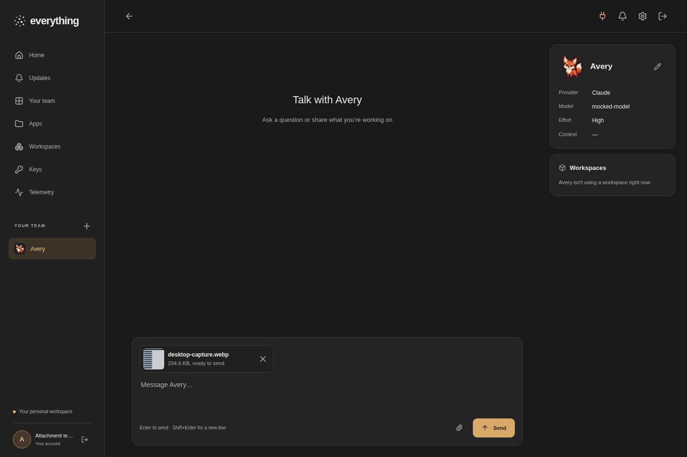
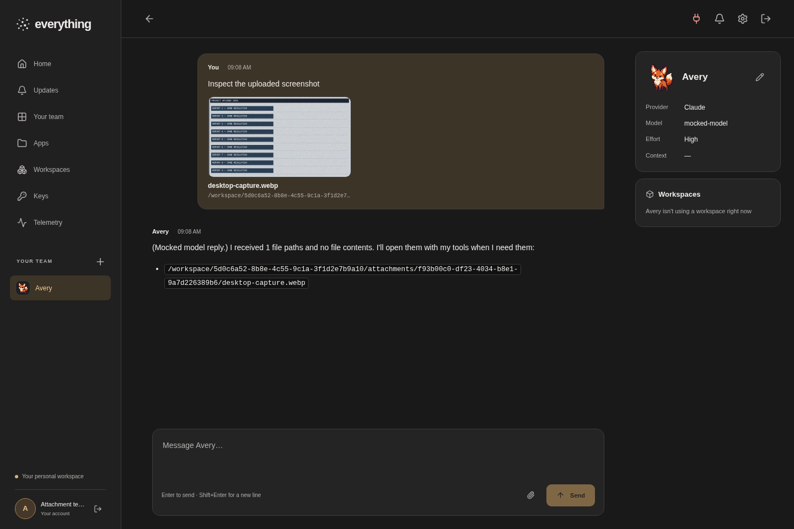
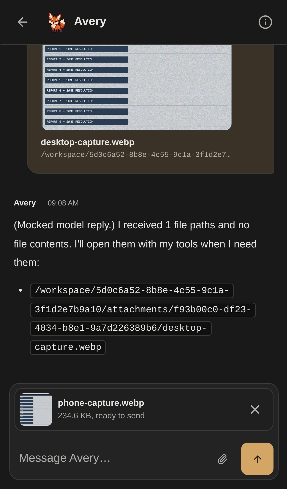
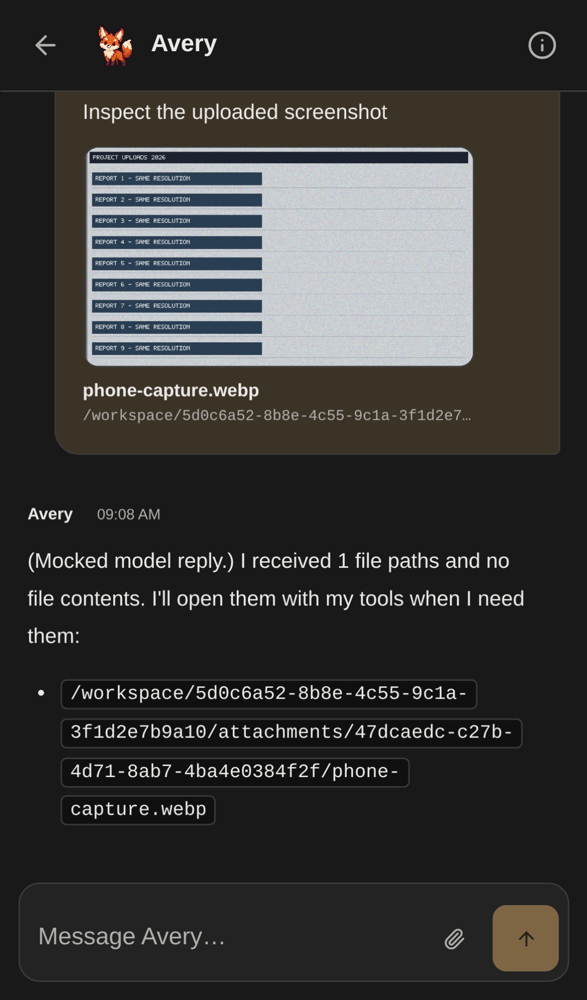

# PNG uploads: actual browser evidence

MAIN ran the committed browser harness at source `2c953f4e7a22b401c8a297a14ddc4ab96354e3da`: **2 passed**, zero unexpected/flaky/skipped/errors, one worker, retry 0. Native browser-command exit **0**, monitor exit **0**, command duration **33.759 s**, reporter duration **32.339855 s**.

The first attempt's browser exit is **unknown**; no completed tests or screenshots were retained and its cause is not established. Exactly one authorized browser-only recovery reused the verified install/build/native Sharp load, the same source/assertions/security/default encoder, and fresh fixtures/ports 5198/18298 with heap 256 MiB. This is separate from the original model-capacity interruption and its one same-Sol continuation. No further browser run was used for this evidence commit.

## What is real

Production UI and handlers, upload/content/ready/send/history/session/runtime HTTP, local Sharp and workspace files are real. Authentication, in-memory records (**not PostgreSQL**), model and unrelated UI metadata are fixtures; external HTTP is blocked. Desktop uses the production file-input handler through `setInputFiles`, not the native OS picker dialog. Phone uses Chromium iPhone 13 emulation with a synthetic `ClipboardEvent` through the production paste handler, not a physical phone or OS clipboard.

The same sole author inspected all four original screenshots at original detail, plus the actual synthetic source PNG and stored WebP reference pair. No serious visible defect was found. The source/stored text remained readable; dense colored grain visibly changed under standard lossy defaults. Every decoded alpha sample matched. Screenshots show UI state; stored-byte integrity, original progress, cleanup, download/header equality and path-only prompts are separate assertions, not claims established from pixels. Raw HTTP captures were not retained, and the model replies shown are mocked rather than live visual recognition.

## Browser fixture measurements

Both cases used the same generated **1280 × 720** PNG: **1,815,417 input bytes → 240,202 stored WebP bytes**, **86.77% smaller** for this synthetic fixture. There is no universal savings or lossless-RGB claim. Sharp 0.35.5 used `.webp()` with no options: quality 80, alphaQuality 100, effort 4, lossless false; no resize/rotation/quality tuning. New eligible uploads only; historical files remain unchanged. Unsupported/APNG/EXIF/16-bit/busy/failed/no-benefit conversions retain the original.

`inputSize`, `received` and progress maximum remain **1,815,417**; the held offset is **1,048,576**, final input chunk **766,841**. Ready metadata uses `desktop-capture.webp` / `phone-capture.webp`, `image/webp`, **240,202** bytes and the actual canonical paths. Each attachment has one permanent file; private partials are zero. The two initial prompts were 622/618 bytes of paths and small metadata, without inline pixels/base64. The assertion records cover full reload, real downloads matching actual stored bytes/headers, send/history and cleanup.

Source SHA256: `9950faf71f2c821ed515ebfb6e01c3035637503d5ea5edd23adf1fb23213f114`.
Stored SHA256: `18268f7cea12fd47ab9eb5e31c48a873f93dd9e360b3c50864c4c4a979b986f5`.

These reference images, prompt text and raw execution manifest are intentionally not published. The bounded `MAIN-BROWSER-EVIDENCE.json` retains their hashes/provenance; `desktop-png-webp.json` and `phone-png-webp.json` contain the assertion records. The four screenshots are unchanged original browser PNGs, distinct from the codec input PNG. They are 1440×960 on desktop and 1170×1992 on phone (390×664 CSS pixels at device scale 3).

## Original browser screenshots

Desktop, after upload and full reload: the composer shows `desktop-capture.webp`, thumbnail and **234.6 KB, ready to send**.

Desktop, after send and reload: history shows the image, canonical WebP name/path and a clearly mocked model reply.

Phone emulation, after synthetic paste/upload and reload: the composer shows `phone-capture.webp` and **234.6 KB, ready to send**. Earlier desktop history remains visible above it.

Phone emulation, after send and reload: history shows `phone-capture.webp`, its image/path and the mocked reply.

The prior [codec benchmark pair and statistics](../png-webp/README.md) are unchanged and are separate service/filesystem measurements. The original 48 attachment tests (including real TCP HTTP/storage/codec/tool flow), six composer tests, builds/checks and source-head CI remain qualified historical results; this evidence commit receives its own automatic exact-head CI. No live PostgreSQL migration or arm64 runtime validation is implied; arm64 remains dependency-packaging evidence. See [implementation and harness details](../../png-webp-uploads.md).
