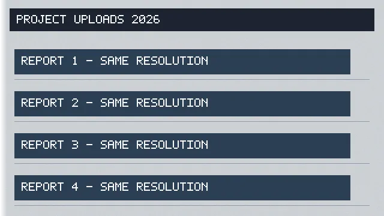

# Synthetic PNG → stored WebP

These files are generated fixtures, with no private user content. The production upload service and workspace storage called the real local codec; the benchmark does not use HTTP. The separate TCP HTTP integration test covers upload, ready metadata, download, send/history and real `image_view`. Authentication, records and the model are fixtures in that test.

| Synthetic case               | Pixels before and after | PNG bytes | Stored WebP bytes |  Saved |
| ---------------------------- | ----------------------- | --------: | ----------------: | -----: |
| Proof with text and alpha    | 640 × 360               |   200,587 |             7,746 | 96.14% |
| Desktop, light grain         | 1920 × 1080             | 2,692,980 |            29,354 | 98.91% |
| Desktop, dense colored grain | 1920 × 1080             | 4,672,682 |           828,186 | 82.28% |
| Desktop, flat                | 1920 × 1080             |    50,871 |            24,164 | 52.50% |

Standard lossy WebP settings remove or change grain and some RGB edge colors. These synthetic measurements are not a universal compression ratio or a lossless claim. The same author inspected all four original/stored pairs with the image tool at original detail: text remained readable; the dense grain visibly changed. Every decoded 8-bit alpha sample was identical in all four cases. No resize, rotation, crop or quality tuning was used.

Original generated PNG, 640 × 360:


Actual stored WebP, 640 × 360:



`BENCHMARK.json` records source, candidate and stored hashes, dimensions, codec versions and alpha comparisons. The two committed images match those recorded hashes. Larger binary pairs remain outside the repository; the deterministic generator uses seed `0x1a194cd`.

Codec: pinned `sharp@0.35.5`, libvips 8.18.7 / libwebp 1.6.0 on Linux x64. `.webp()` has no options: documented defaults are quality 80, alphaQuality 100, effort 4 and lossless false. Sharp performs its normal sRGB conversion and metadata stripping; EXIF-bearing PNGs remain original. See [Sharp's WebP defaults](https://sharp.pixelplumbing.com/api-output/#webp).

The original successful benchmark was retained without re-running its encodes. Only its provenance sentence was clarified in the committed JSON: it uses the upload service over files, while HTTP is tested separately. Measurement fields are unchanged.

To reproduce on a supported local runtime, from the repository root, supply a fresh path that does not yet exist:

```bash
pnpm --filter @everything/everything... build
pnpm --filter @everything/everything exec tsx src/attachment/test/benchmark-png-webp.ts /tmp/png-webp-benchmark-NEW-UNIQUE
```

See [the implementation and browser handoff](../../png-webp-uploads.md). These are codec evidence images, not screenshots of a browser run.
